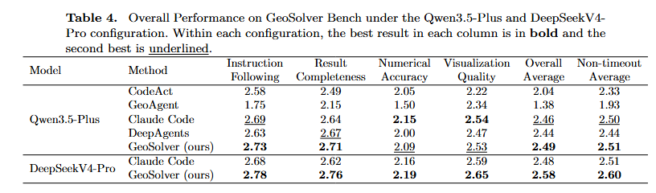
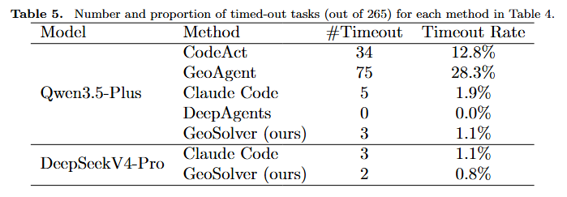
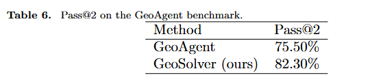
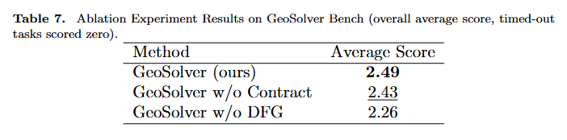

# GeoSolver

A benchmark and agent framework for **geospatial analysis tasks**. Given a natural-language
task, a set of geographic datasets, and an expected-output specification, an agent must
generate and run Python code that produces the correct answer (a number, a data file, and/or
a visualization).

The project provides several agent implementations of increasing sophistication, a batch
runner to execute them over task datasets, and an LLM-based evaluation harness to score the
generated solutions.

---

## Table of Contents

- [Project Structure](#project-structure)
- [Installation](#installation)
- [Configuration](#configuration)
- [Quick Start](#quick-start)
- [Agent Methods](#agent-methods)
- [Running Agents (`run_agent.py`)](#running-agents-run_agentpy)
- [Task & Output Format](#task--output-format)
- [Evaluation](#evaluation)
- [Datasets](#datasets)
- [License](#license)
- [Other Entry Points](#other-entry-points)

---

## Project Structure

```
Geosovler/
├── config.py                 # Central config loader (.env + config.ini)
├── config.ini                # Paths, model name, timeouts
├── requirements.txt          # Python dependencies (shared by the whole project)
├── .env                      # API keys / secrets (not committed)
│
├── run_agent.py              # ▶ Main batch runner: run an agent over a task dataset
├── run_eval.py               # ▶ Evaluate generated solutions vs. reference solutions
├── run_eval_on_geoagent.py   # ▶ Evaluate task outputs with the Claude Code CLI
├── run_geosolver_on_geoagent.py  # ▶ Run geosolver/geoagent over the GeoAgent dataset
│
├── Agents/
│   ├── build_codeact.py                    # CodeAct: single-LLM baseline agent
│   ├── build_geosolver_without_dfg.py      # Geosolver_without_DFG: plan-then-code (no data-flow graph)
│   ├── build_geosolver.py                  # Multi-agent DAG pipeline (with contracts)
│   ├── build_geosolver_without_contract.py # Simplified multi-agent pipeline
│   ├── build_deepagent.py                  # DeepAgents-library wrapper
│   ├── build_geoagent.py                   # Remote GeoAgent HTTP API client
│   ├── build_ClaudeCode.py                 # Claude Code CLI wrapper
│   ├── utils.py                            # Shared helpers
│   ├── tools/                              # Agent tools (graph, sandbox, code framework, …)
│   └── prompts/                            # Prompt templates per agent variant
│
├── GeoAgent/                 # Ported multi-agent GeoAgent service (see GeoAgent/README.md)
│
├── Data/
│   ├── datasets.json         # 265 benchmark tasks (metadata + tasks)
│   └── <source>/             # Per-source geographic data files (shp, tif, zip, …)
│
├── Eval/                     # LLM-based evaluator sub-project
│   ├── main.py               # Evaluator entry point
│   ├── eval/agent.py         # RemoteSensingEvaluator implementation
│   └── sandbox/runner.py     # Sandbox used by the evaluator
│
└── Output/                   # Run outputs (generated at runtime, git-ignored)
    ├── runs/                 # Agent run results
    ├── eval/                 # Evaluation results
    └── scratch/              # Sandbox scratch space
```

---

## Installation

Requires **Python 3.12**. The project depends on a heavy geospatial stack (GDAL, GEOS, PROJ,
rasterio, geopandas), so a **conda environment is strongly recommended**:

```bash
# Create and activate an environment
conda create -n geo python=3.12
conda activate geo

# Install the geospatial stack via conda (recommended for GDAL/GEOS/PROJ)
conda install -c conda-forge gdal geos proj geopandas rasterio

# Install the remaining Python dependencies
pip install -r requirements.txt
```

Install [ClaudeCode](https://github.com/anthropics/claude-code)

---

## Quick Start

### 1. Set LLMs API KEY

Create a `.env` file in the project root with your model API credentials:

```bash
OPENAI_API_KEY=your_api_key
OPENAI_API_BASE=XXXX   # or any OpenAI-compatible endpoint
OPENAI_MODEL=XXXX
```

### 2. Agent settings — `config.ini`

```ini
[PATH]
DATA_PATH   = ./Data  # datasets path
Output_PATH = ./Output  # agent workspace path

[Model]
name            = XXX   # langchain "provider:model" identifier
temperature     = 1
request_timeout = 120                   # per-request LLM timeout (seconds), shared by all agents

[GeoAgent]
base_url = http://127.0.0.1:8002        # remote GeoAgent service (for --method geoagent)

[Eval]
timeout_seconds = 1200                  # default per-task time limit
max_workers     = 4
```

---

### 3. Run Agent(`CodeAct`, `Geosolver_without_DFG`, `geosolver`, `deepagent`, `claude_code`)
> for `CodeAct`, `Geosolver_without_DFG`, `geosolver`, `deepagent`, `claude_code`, you can directly run_agent


Run the single-LLM baseline agent over a task file and inspect the output:

```bash
python run_agent.py \
    --method CodeAct \
    --task_path Data/datasets.json \
    --output_path Output/runs/my_first_run \
    --retry 2
```
| Argument | Default | Description |
|----------|---------|-------------|
| `--method` | *(required)* | One of the [agent methods](#agent-methods) above. |
| `--task_path` | *(required)* | Path to a task JSON file (see [format](#task--output-format)). |
| `--output_path` | timestamped dir under `Output/runs/` | Where results are written. |
| `--verbose` / `--no-verbose` | verbose on | Print agent internal messages. |
| `--retry` | `1` | Max retries per task on timeout/failure. |
| `--workers` | `1` | Parallel worker processes (`1` = serial). |
| `--timeout` | `config EVAL_TIMEOUT_SECONDS` | Per-task time limit in seconds. |

Example — run `geosolver` on the full dataset with a 10-minute per-task cap and 4 workers:

```bash
python run_agent.py \
    --method geosolver \
    --task_path Data/datasets.json \
    --timeout 600 \
    --workers 4
```


`run_agent.py` supports the following `--method` values:

| Method | Description |
|--------|-------------|
| `CodeAct` | Single LLM with a code-execution tool. Directly generates and runs a script. |
| `Geosolver_without_DFG` | `CodeAct` with an explicit planning stage before coding (GeoSolver without the data-flow graph). |
| `geosolver` | **Multi-agent DAG pipeline.** A Data Explorer inspects the inputs, a Graph Planner builds a validated DAG of the analysis, a Contract Generator attaches pre/post-conditions to each node, a Code Generator scaffolds and fills in code, and outputs are verified. |
| `geosolver_without_contract` | Simplified `geosolver`: plan → explore → code → submit, without contract generation or output verification. |
| `deepagent` | Wrapper around the [DeepAgents](https://pypi.org/project/deepagents/) library. |
| `geoagent` | Client for the **GeoAgent HTTP service** (configured via `[GeoAgent] base_url`). Requires the service to be running — see [`GeoAgent/README.md`](GeoAgent/README.md) for how to start it. |
| `claude_code` | Wrapper that drives the Claude Code CLI (`claude -p`). |


### 4. Run Agent(GeoAgent)
For GeoAgent, you need to start the [`GeoAgent/`](GeoAgent/README.md) service first.

The `GeoAgent/` service is adapted from a standalone project. Because the upstream
source could not run as-is here and did not fit our evaluation setup, it has been
**modified as appropriate** (removed hard-coded paths/secrets, made the dataset root
configurable, adapted the service for GeoSolver). The original unmodified source is
archived at <https://doi.org/10.6084/m9.figshare.29145008>.

Run the following command after ensuring the service starts successfully:

```bash
python run_agent.py \
    --method geoagent \
    --task_path Data/datasets.json \
    --timeout 1200 \
    --workers 4
```
---

### Evaluation

Scores generated solutions against reference solutions across multiple dimensions.

```bash
python run_eval.py \
    --solutions-root Output/runs/<run_dir> \
    [--ref-solutions-dir Output/solutions] \
    [--resume]
```

Reads `<solutions-root>/generated_solutions.json`, writes `<solutions-root>/eval_result.json`,
and checkpoints to `<solutions-root>/.eval_checkpoint.json`.

## Experiment for Table 4



To reproduce Experiment 3, run run_agent.py sequentially for the `CodeAct`, `Geosolver_without_DFG`, `geosolver`, `deepagent`, and `claude_code` methods.
Use different model configurations by setting different LLM APIs and model names（Qwen3.5-Plus and DeepSeekV4-Pro）

```bash
python run_agent.py --method CodeAct    --task_path Data/datasets.json
python run_agent.py --method Geosolver_without_DFG    --task_path Data/datasets.json
python run_agent.py --method geosolver    --task_path Data/datasets.json
python run_agent.py --method deepagent    --task_path Data/datasets.json
python run_agent.py --method claude_code    --task_path Data/datasets.json
python run_agent.py --method geoagent    --task_path Data/datasets.json
```

After the task is completed, evaluate the corresponding method:

```bash
python run_eval.py \
    --solutions-root Output/runs/<run_dir> \
    [--ref-solutions-dir Output/solutions] \
    [--resume]
```
## Experiment 5


```bash
python count_timeouts.py
```

## Experiment for Table 6


The [`GeoAgent/`](GeoAgent/README.md) service also needs to be started first.

And run tasks:
```bash
python run_geosolver_on_geoagent.py --method geosovler
python run_geosolver_on_geoagent.py --method geoagent
```
Evaluation:

```bash
python run_eval_on_geoagent.py --run-id <run_id>        # a specific run
```

---

## Experiment for Table 7


Run tasks:
```bash
python run_agent.py --method geosovler_without_contract
python run_agent.py --method geoagent_without_dfg
```
Evaluation:

```bash
python run_eval.py \
    --solutions-root Output/runs/<run_dir> \
    [--ref-solutions-dir Output/solutions] \
    [--resume]
```

---

## Datasets

The benchmark task metadata is in [`Data/datasets.json`](Data/datasets.json). The
per-source geographic data files are **not** included in this repository because of
their size and third-party licensing; see [`Data/README.md`](Data/README.md) for
provenance and terms.

---

## License

The GeoSolver source code is licensed under the [Apache License 2.0](LICENSE).
Copyright 2026 The GeoSolver Authors.

Two parts of the repository are **not** covered by that license:

- **`GeoAgent/`** — adapted from *GeoAgent: a hierarchical LLM-based multi-agent
  architecture for autonomous spatial analysis* (Lin; archived at
  <https://doi.org/10.6084/m9.figshare.29145008>), which is licensed under
  [CC BY 4.0](https://creativecommons.org/licenses/by/4.0/). The adapted code
  keeps that license and is **not** covered by Apache-2.0. The modifications made
  for GeoSolver are described in [`GeoAgent/README.md`](GeoAgent/README.md); see
  also [`NOTICE`](NOTICE).
- **`Data/`** — benchmark datasets from third-party sources, each remaining under
  its original terms. See [`Data/README.md`](Data/README.md).

If you redistribute this project, keep `LICENSE` and `NOTICE` with it.
